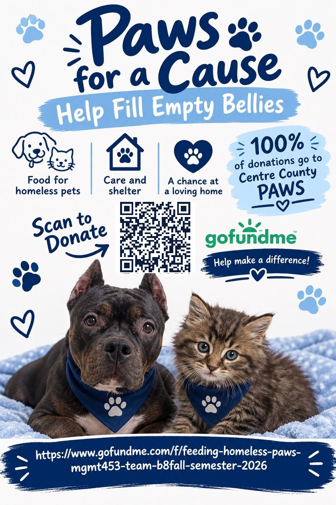

# Paws for a Cause

Fundraiser website for [Centre County PAWS](https://www.centrecountypaws.org), the animal shelter in State College, PA. Built for Team B8's term project at Penn State in Fall 2026.

- **Live site:** https://aryamanajmera.github.io/paws-for-a-cause/
- **Donate:** [GoFundMe campaign](https://www.gofundme.com/f/feeding-homeless-paws-mgmt453-team-b8fall-semester-2026)

## What's on the site

- Donate buttons that go straight to the GoFundMe
- The Paws for a Cause tee
- The PAWS Can Drive with a count of the cans of pet food filled so far
- Photos from our visit to the shelter, where we met a dog named Sky
- A poster to share

## How it's built

One static page. `index.html` holds the HTML, CSS and JavaScript and the images live in `img/`. GitHub Pages serves the site from the `main` branch, so every change pushed to `main` goes live.

## Run it locally

Download the repo and open `index.html` in a browser. Nothing to install.
